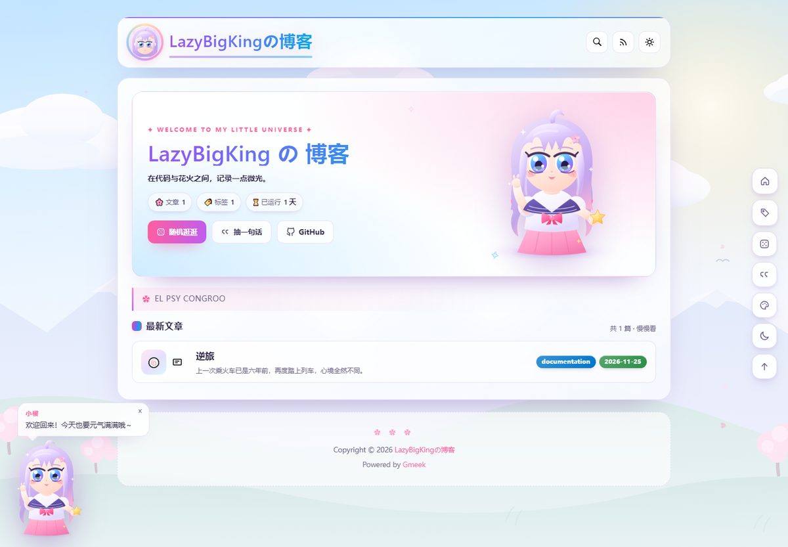
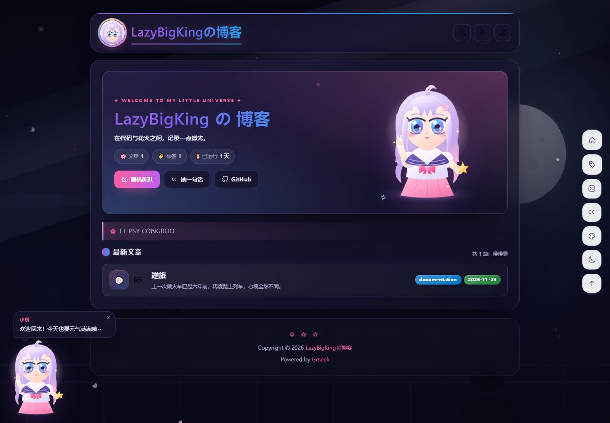

# ✿ 二次元主题使用说明（Sakura Dream）

这套主题把原本朴素的 Gmeek 博客改造成「樱花 + 玻璃拟态」的二次元风格，
所有装饰都是手写 SVG，不依赖外部图床，**Gmeek 每次重新生成页面也会自动保留**。





---

## 一、都改了什么

| 位置 | 说明 |
| --- | --- |
| `static/anime/` | 主题的样式、脚本、配置和全部插图（Gmeek 构建时会整目录复制到 `docs/anime/`） |
| `config.json` | 增加 `allHead` 注入代码，以及建站日期、页脚小字 |
| `blogBase.json` | 同步了同样的字段，兼容 Gmeek 的「单篇文章更新」流程 |
| `docs/` | 已把主题挂到现有页面，推上去就能直接看到效果（下次 Action 构建会重新生成成同样效果） |
| `THEME.md` | 就是这份说明 |

### 新功能一览

- **5 套背景**：晴空 / 樱花 / 黄昏 / 星夜 / 极光，默认跟随明暗主题自动切换，右下角按钮可手动切换并记住选择
- **首页 Hero 横幅**：渐变标题、打字机文案、文章/标签/运行天数徽章、随机文章 & 抽一句话按钮
- **看板娘「小樱」**：会打招呼、点她会说话、会撒花；台词和形象都能换
- **浮动按钮坞**：一排可自定义的快捷按钮（首页 / 标签 / 随机 / 语录 / 换背景 / 昼夜 / 回顶部），支持增删改
- **樱花特效**：Canvas 飘落花瓣、鼠标星光、点击花瓣爆开、Konami 彩蛋（↑↑↓↓←→←→BA）
- **文章页增强**：顶部阅读进度条、字数 / 阅读时长 / 日期 / 标签、自动目录（滚动高亮）、图片点击放大、一键复制链接
- **标签页美化**：中文标题、标签胶囊、搜索框
- **明暗双主题 + 移动端适配 + 减弱动效支持**（系统开启「减少动态效果」时自动关闭花瓣和动画）

---

## 二、文件结构

```
static/anime/
├── anime.css      # 全部样式（1518 行，按模块分节，改配色看开头变量）
├── anime.js       # 交互逻辑（樱花、看板娘、按钮、目录、灯箱……）
├── config.js      # ★ 你要改的基本都在这里
├── avatar.svg     # 页头头像
├── mascot.svg     # 看板娘立绘
├── favicon.svg    # 浏览器标签图标
├── bg-day.svg     # 晴空
├── bg-sakura.svg  # 樱花
├── bg-dusk.svg    # 黄昏
├── bg-night.svg   # 星夜
└── bg-aurora.svg  # 极光
```

> Gmeek 每次构建会先清空 `docs/`，再把 `static/` 里的东西复制进去。
> 所以**新增图片请放进 `static/anime/`**，不要只放在 `docs/` 里。

---

## 三、开始自定义

### 1. 加一个自己的按钮（最常改）

打开 `static/anime/config.js`，找到 `buttons` 数组：

```js
buttons: [
  { label: "回到首页", href: "", icon: "home" },
  { label: "标签云", href: "tag.html", icon: "tag" },
  { label: "随机文章", action: "random", icon: "random" },
  { label: "抽一句话", action: "quote", icon: "quote" },
  { label: "更换背景", action: "background", icon: "palette" },
  { label: "切换昼夜", action: "theme", icon: "moon" },
  { label: "回到顶部", action: "top", icon: "top" }
]
```

- 想加友链：复制一行改成 `{ label: "友链", href: "https://example.com", icon: "link" }`
- `href` 写相对路径（如 `tag.html`）或完整网址都可以；`href: ""` 表示首页
- 想打开新窗口：加 `blank: true`
- 不想要某个按钮：删掉那一行即可

可用 `action`：

| action | 效果 |
| --- | --- |
| `random` | 随机打开一篇文章 |
| `quote` | 弹出一句话 |
| `background` | 切换到下一张背景 |
| `theme` | 明 → 暗 → 跟随系统 循环 |
| `top` | 平滑回到顶部 |
| `mascot` | 让看板娘说句话 |
| `share` | 复制当前页面链接 |

可用 `icon`：`home` `tag` `random` `quote` `palette` `top` `moon` `github` `rss` `link` `heart` `book` `star` `music`。

### 2. 换背景 / 加自己的图

```js
backgrounds: [
  { id: "day",    label: "晴空", url: "anime/bg-day.svg",    theme: "light" },
  { id: "sakura", label: "樱花", url: "anime/bg-sakura.svg", theme: "light" },
  { id: "night",  label: "星夜", url: "anime/bg-night.svg",  theme: "dark" },
  ...
]
```

- `theme`：`light` 只在浅色模式自动使用，`dark` 只在深色模式，`any` 都行
- `url` 写 `anime/你的图片.jpg`，把图片放进 `static/anime/` 即可（支持 jpg/png/webp/svg）
- `defaultBackground: "auto"` 表示跟随昼夜；改成某个 `id` 可以固定默认背景

建议图片尺寸 1600×900 以上，横图效果最好。

### 3. 改语录

```js
quotes: [
  { text: "愿你所有的努力，都在某个春天开出花来。", from: "本站随笔" },
  ...
]
```

`from` 会显示在句子下方，可以留空。

### 4. 看板娘

```js
mascot: {
  enabled: true,
  name: "小樱",
  image: "anime/mascot.svg",   // 换成自己的立绘（建议透明底 PNG/SVG）
  greetings: ["欢迎回来！今天也要元气满满哦～", ...]
}
```

- 首页加载 1.8 秒后会主动打招呼；其它页面只有点击她才会说话，不会挡文章
- 手机上会自动隐藏看板娘，避免遮挡正文
- 不想要她：`enabled: false`

### 5. 特效开关

```js
effects: {
  petals: true,       // 飘落樱花
  petalCount: 26,     // 花瓣数量（手机自动减少）
  cursor: true,       // 鼠标星光（仅桌面）
  clickBurst: true,   // 点击花瓣
  avatarRing: true    // 头像旋转光环
}
```

### 6. 首页文案 & 建站日期

```js
site: {
  name: "LazyBigKing の 博客",
  eyebrow: "✦ WELCOME TO MY LITTLE UNIVERSE ✦",
  typed: ["在代码与花火之间，记录一点微光。", ...],   // 打字机轮播
  startDate: "2026-11-25",   // 首页「已运行 N 天」和页脚天数
  github: "https://github.com/LazyBigK1ng"
}
```

同时 `config.json` 里的 `title`、`subTitle`、`startSite` 也是站点级的文案，可以一起改。

### 7. 改配色

打开 `static/anime/anime.css` 最上面的变量区：

```css
:root {
  --a-accent: #ff5f9e;      /* 主强调色 */
  --a-accent-2: #9b6bff;    /* 次强调色 */
  --a-accent-3: #3fd0ff;    /* 点缀色 */
  --a-grad: linear-gradient(100deg, #e0508c, #8b5cf6 38%, #0ea5e9 68%, #ec4899);
  --a-radius: 22px;         /* 卡片圆角 */
}
```

深色模式的配色紧跟在其后的 `.anime[data-color-mode="dark"]` 里，改完记得两边都看一眼。

### 8. 换头像 / 图标

- 头像：替换 `static/anime/avatar.svg`（或改 `config.js` 里 … 其实头像由脚本接管，
  想用自己的图就改 `enhanceHeader` 中 `asset('anime/avatar.svg')` 这一行，或直接替换同名文件）
- 标签页图标：替换 `static/anime/favicon.svg`

### 9. 文章页功能开关

```js
post: {
  toc: true,               // 自动目录
  tocMinHeadings: 2,       // 至少 2 个标题才显示目录
  meta: true,              // 字数 / 阅读时长 / 日期 / 标签
  progress: true,          // 顶部阅读进度
  copyLink: true,
  lightbox: true,
  wordsPerMinute: 380
}
```

---

## 四、本地预览

主题里用了 `fetch` 读取 `rss.xml` / `postList.json`，**直接双击 HTML 会失败**，请起一个本地服务：

```bash
# 在仓库根目录
python -m http.server 8000 --directory docs
# 然后打开 http://localhost:8000
```

也可以只预览首页：`http://localhost:8000/index.html`。

---

## 五、发布

```bash
git add .
git commit -m "🎨 add anime sakura theme"
git push
```

- 现有的 GitHub Actions（`.github/workflows/Gmeek.yml`）会在推送 / 新建 Issue / 每天定时重新构建
- 构建时会自动把 `static/anime/` 复制到 `docs/anime/`，并把 `config.json` 里的 `allHead` 注入每个页面
- 也就是说：**以后只要在 GitHub 上写 Issue，新文章依然会自动套上主题**

⚠ 三个不要：

1. **不要删 `config.json` 里的 `allHead`**，否则主题样式和脚本不会加载
2. **不要把图片只放进 `docs/`**，`docs/` 每次构建都会被清空
3. **不要直接改 `docs/*.html` 里的主题代码**，构建后会被覆盖；要改就改 `static/anime/`

---

## 六、实现原理（想继续折腾可以看）

`config.json` 的 `allHead` 会在每个页面的 `<head>` 里插入一小段引导脚本：

1. 给 `<html>` 加上 `anime` 类（所有样式都以 `.anime` 为前缀，不污染原样式）
2. 根据当前路径算出站点根目录（兼容 `用户名.github.io` 和 `用户名.github.io/仓库名` 两种部署方式，也兼容 /post/ 子目录）
3. 动态插入 `anime/anime.css`、`anime/config.js`、`anime/anime.js`

页面端的个性化全部由 `anime.js` 完成：查 `#content` 判断是首页 / 文章 / 标签页，再按需插入 Hero、按钮坞、目录等节点，不会破坏 Gmeek 自己的搜索、评论、主题切换逻辑。

浏览器本地只存两个键：

- `meek_theme`：Gmeek 原有的明暗模式
- `anime_bg`：你手动选过的背景 id（清除它就会回到「跟随昼夜」）

---

## 七、素材与版权

`static/anime/` 里的背景、看板娘、头像、favicon 全部是为这个博客手写的 SVG 矢量图，
可以随博客自由修改、二次创作。如果你替换成网络图片，请自行确认授权。

主题代码（CSS/JS）可以随意取用，不需要署名。
祝你玩得开心 ✿
